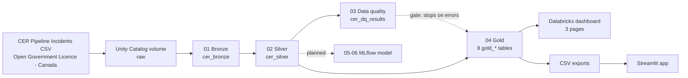
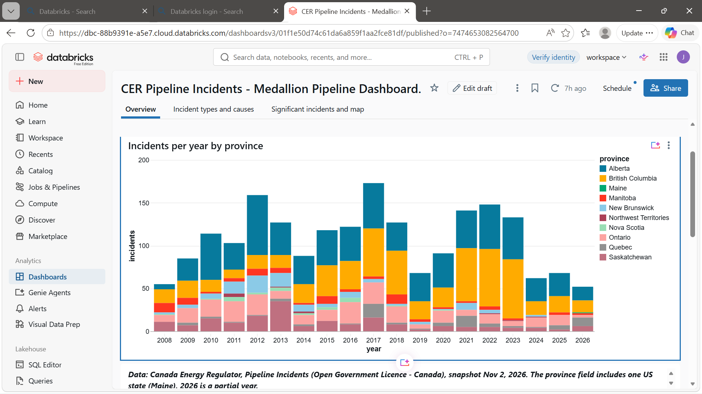
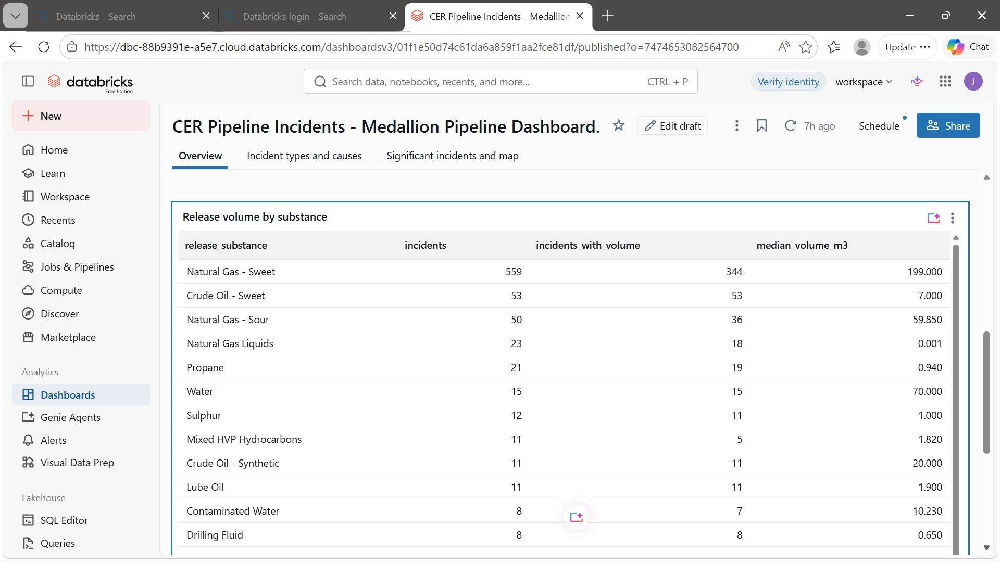
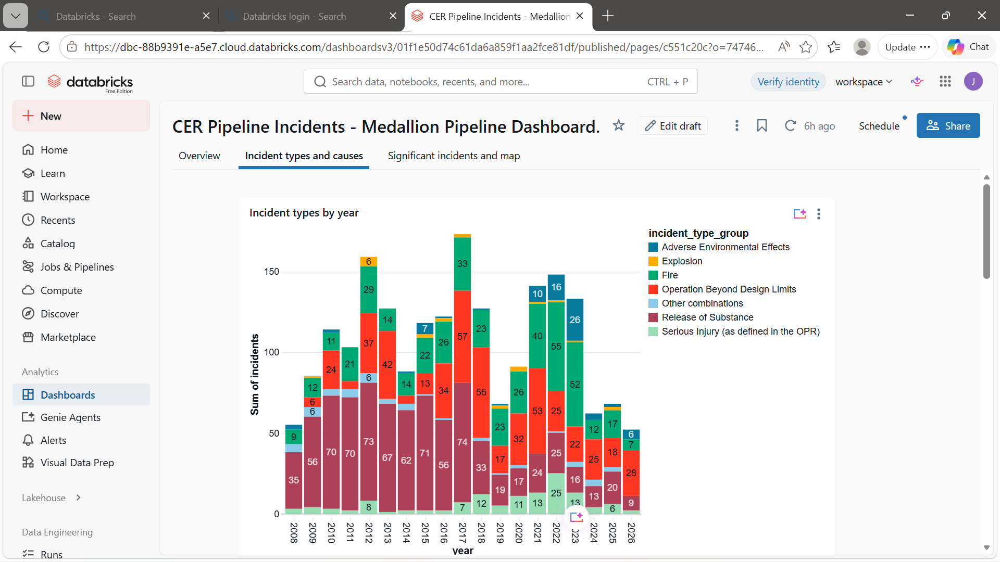
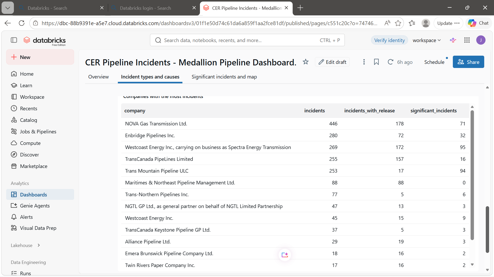
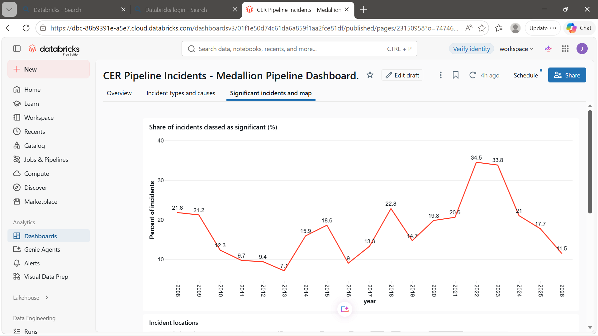
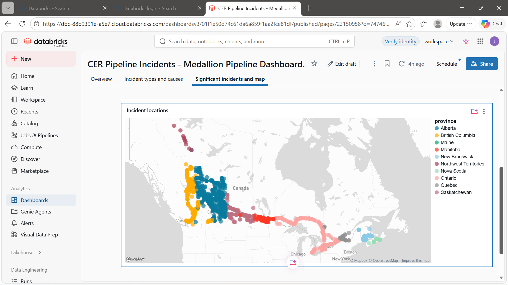

# Module 13: CER Pipeline Incidents - Databricks Medallion Pipeline

A bronze, silver and gold lakehouse pipeline on Databricks (PySpark and Delta Lake) for the Canada Energy Regulator (CER) Pipeline Incidents open dataset, with a data-quality gate, eight gold tables, a three-page Databricks dashboard and a deployed Streamlit app.

**Live app:** `<add Streamlit Cloud URL>`

**Data:** Canada Energy Regulator, Pipeline Incidents (CSV), published under the Open Government Licence - Canada. The snapshot used here was downloaded on Nov 2, 2026 and holds 2,034 incidents.

## Status

| Part | Status |
|---|---|
| Bronze, silver, data quality, gold notebooks (01-04) | Done and run on Databricks Free Edition |
| Databricks dashboard (3 pages) | Done (screenshots below; the workspace is private) |
| Streamlit app | Done, reads CSV exports of the gold tables |
| MLflow model for the `significant` flag (05-06) | Planned, not built yet |

## Architecture



## Notebooks

Notebooks are in Databricks source format (`.py`). Import them into a workspace and run them in order.

| Notebook | What it does | Output |
|---|---|---|
| `01_bronze_ingest` | Reads the raw CSV as text and writes it unchanged; only column names are normalized because Delta does not allow spaces or parentheses | `cer_bronze` |
| `02_silver_clean` | Trims text, converts dates, numbers and counts to real types, adds helper columns, removes duplicate incident numbers, and prints a parse report | `cer_silver` |
| `03_data_quality` | Runs 13 checks (4 error, 9 warning), appends the results to a table, and stops the notebook if an error check fails | `cer_dq_results` |
| `04_gold_aggregates` | Builds eight aggregate tables for the dashboards and exports them as CSV | `gold_*` tables |

### Design choices

- **Bronze keeps values as received.** Every column is read as text, so nothing is lost before cleaning.
- **Failures are counted, not hidden.** Databricks serverless runs in ANSI mode, so a plain cast of bad text raises an error. Silver uses `try_cast` and `try_to_timestamp`, then reports how many values failed to parse for each column.
- **Duplicates are reported before removal.** The notebook prints how many duplicate incident numbers it found, then keeps one row per number.
- **Helper columns:** `volume_m3` (numeric release volume), `significant_flag` (boolean), `is_canadian_province`, and `release_substance` (empty when nothing was released).

### Data quality

All 13 checks passed on the Nov 2, 2026 snapshot (2,034 rows in bronze and silver, no row loss).

- **Error checks (block the pipeline):** incident number present, incident number unique, province present, release volume not negative.
- **Warning checks:** year present and in range, reported date parsed and not in the future, year agrees with reported date, closed date not before reported date, coordinates inside Canada and the border area, significant flag readable.

## What the data shows

- 2,034 incidents were reported from 2008 to 2026. Alberta (713) and British Columbia (580) account for 64% of them.
- 846 incidents (42%) involve a released substance. Natural Gas - Sweet accounts for 559 of those, or 66%.
- 361 incidents (18%) are classed as significant. The share ranged from 7.1% in 2013 to 34.5% in 2022 and 33.8% in 2023. This describes the pattern only. Reporting rules and classification practice can change over time, so the data does not show why the share rose.
- The companies with the most incidents are NOVA Gas Transmission (446), Enbridge Pipelines (280), Westcoast Energy operating as Spectra Energy Transmission (269), TransCanada PipeLines (255) and Trans Mountain Pipeline (253).

## Limitations

- **Snapshot:** the data is a downloaded snapshot, not a live feed. 2026 is a partial year.
- **Release volumes are sparse:** only 594 incidents (29%) have a numeric volume. Medians use those incidents only, and volumes are as reported in cubic metres. Gases and liquids may be reported on different bases, so compare within a substance, not across substances.
- **Province field:** it includes one US state (Maine) for a cross-border pipeline.
- **Company names are not fully harmonised:** variant spellings of NGTL are merged in the dashboard query only, and "Westcoast Energy Inc." appears separately from "Westcoast Energy Inc., carrying on business as Spectra Energy Transmission". Standardizing names in the silver layer is a planned improvement.
- **Dashboard access:** the Databricks dashboard lives in a private Free Edition workspace, so screenshots are included. The Streamlit app is the public view.
- **No model yet:** notebooks 05 and 06 (MLflow) are not built, so this module makes no claims about prediction.

## Screenshots








<details>
<summary>More dashboard screenshots</summary>


</details>
## Repository layout

```
module-13-databricks-medallion-mlflow/
├── app.py                  Streamlit dashboard (reads data/gold_*.csv)
├── requirements.txt
├── conftest.py
├── notebooks/              01-04 Databricks notebooks (source format)
├── src/naming.py           column-name helpers (unit tested)
├── tests/test_naming.py
├── docs/                   dashboard screenshots
└── data/                   gold CSV exports used by the Streamlit app
```

## Run locally

```
pip install -r requirements.txt
streamlit run app.py
pytest
```

## Source

Canada Energy Regulator, Pipeline Incidents, Open Government Licence - Canada.